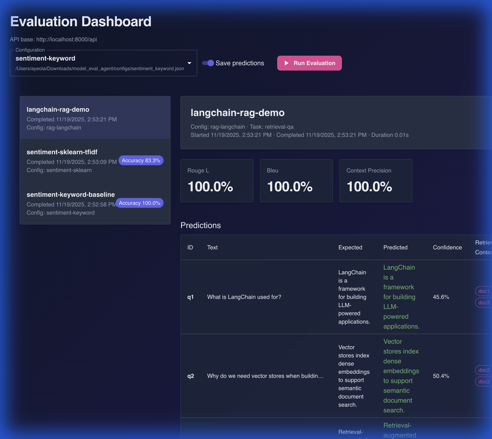

# Evaluation Agent



A comprehensive, end-to-end evaluation stack for text-classification models. This project provides a modular Python agent for orchestrating evaluations, a FastAPI backend for management, and a modern React dashboard for visualization.

## Key Features

*   **Modular Evaluation Engine**: Orchestrate datasets, model adapters, and metrics with ease.
*   **Modern Dashboard**: A beautiful, dark-themed React UI with glassmorphism effects to visualize run history and details.
*   **Real-World Data Integration**: Includes presets for evaluating against real-world datasets (e.g., IMDb sentiment analysis).
*   **Run History Management**: Persist evaluation results to SQLite and easily clear history directly from the UI.
*   **Extensible Architecture**: Easily register new models, datasets, and metrics.

## Project Layout

```
configs/                  # Evaluation configurations (JSON)
data/                     # Datasets (JSONL)
frontend/                 # React + Vite dashboard
scripts/                  # Utility scripts (data fetching, training)
src/eval_agent/           # Core Python package (agent, API, storage)
tests/                    # Regression tests
```

## Quickstart

### 1. Install Dependencies

**Backend**
```bash
pip install -e .
```

**Frontend**
```bash
cd frontend
npm install
cd ..
```

### 2. Prepare Data & Models

Download the real-world sentiment dataset and train the local scikit-learn model:

```bash
# Fetch IMDb dataset
python scripts/fetch_data.py

# Train local model
python scripts/train_sentiment_model.py
```

### 3. Run the Stack

You can run the backend and frontend separately, or use the provided CLI tools.

**Start the API Server**
```bash
python -m eval_agent.cli serve --host 0.0.0.0 --port 8000
```

**Start the Dashboard**
```bash
cd frontend
npm run dev
```

Visit `http://localhost:5173` to access the dashboard.

## Usage

### Running Evaluations

You can trigger evaluations directly from the dashboard or via the CLI:

```bash
# Run keyword baseline
python -m eval_agent.cli run configs/sentiment_keyword.json

# Run real-world sentiment analysis
python -m eval_agent.cli run configs/sentiment_realworld.json
```

### Managing History

The dashboard lists all historical runs. You can view detailed metrics and predictions for each run. To reset your environment, use the **"Clear"** button in the history sidebar.

## Deployment

### Render & Heroku

The repository includes `render.yaml` and `heroku.yml` for easy deployment to PaaS providers.

*   **Render**: Connect your repo to deploy the API and static frontend automatically.
*   **Heroku**: Use the container stack to deploy the Dockerized application.

## Extending

The agent is designed to be extended:

*   **Datasets**: Subclass `eval_agent.datasets.base.Dataset` and use `@DATASET_REGISTRY`.
*   **Models**: Subclass `eval_agent.models.base.ModelAdapter` and use `@MODEL_REGISTRY`.
*   **Metrics**: Subclass `eval_agent.metrics.base.Metric` and use `@METRIC_REGISTRY`.

See `src/eval_agent/` for implementation details.
